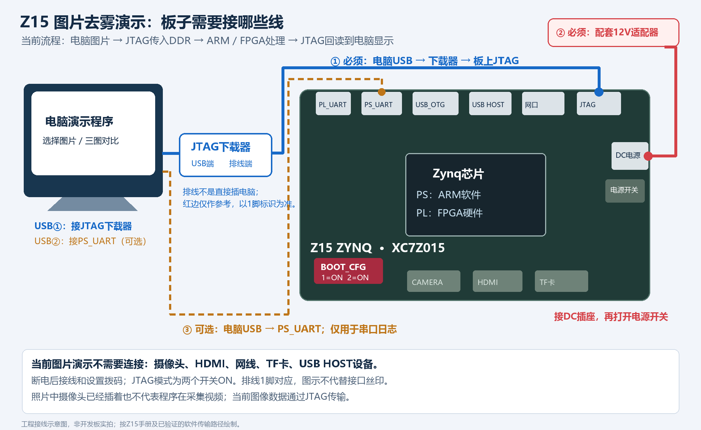

> 历史阶段文档：下文的“当前”“默认”“本轮”描述当时实现。当前运行入口和执行分工见[版本说明](../CURRENT_VERSION.md)，构建步骤见[构建指南](../BUILD.md)。

# Z15 当前图片演示接线

## 必须连接

1. 电脑 USB -> JTAG 下载器 USB 端；下载器排线 -> 板上标有 JTAG 的排针。
2. 配套 12V 电源适配器 -> 板上 DC 电源插座，然后打开电源开关。
3. 断电时将 BOOT_CFG 的 1、2 都拨到 ON，选择 JTAG 模式。排线以接口 1 脚标识对应，红边只作参考。

## 可选

电脑另一个 USB -> PS_UART，供串口日志观察。当前电脑演示程序本身通过 JTAG 收发数据，不依赖串口。
不要把 PS_UART、PL_UART、USB_OTG 或 USB HOST 当作 JTAG 下载口。

## 当前不需要

摄像头、HDMI、网线、TF卡、USB HOST外设。照片上已有摄像头不表示程序在采集摄像头视频。需要拔插板上模块时先断电。

## 接线依据

按 Z15 本地官方手册核对：底板 DC 插座推荐配套12V电源（手册标注DC6~16V输入范围），JTAG启动模式两个拨码均ON。不要把12V接到5V/3.3V排针。
图是工程示意图，未伪装成实拍；实际接口位置与方向按底板丝印确认。通电连接示意不替代厂家硬件说明。
